# SharePoint Smart Copy — WPF Desktop App

   

A free and open source Windows desktop application for copying files, libraries, and pages between SharePoint Online site collections — preserving version history, metadata, and custom columns.

  

---

## Screenshots

| | |
|---|---|
| 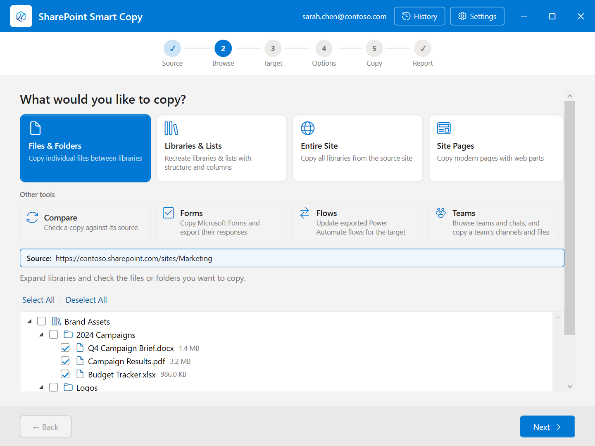 | 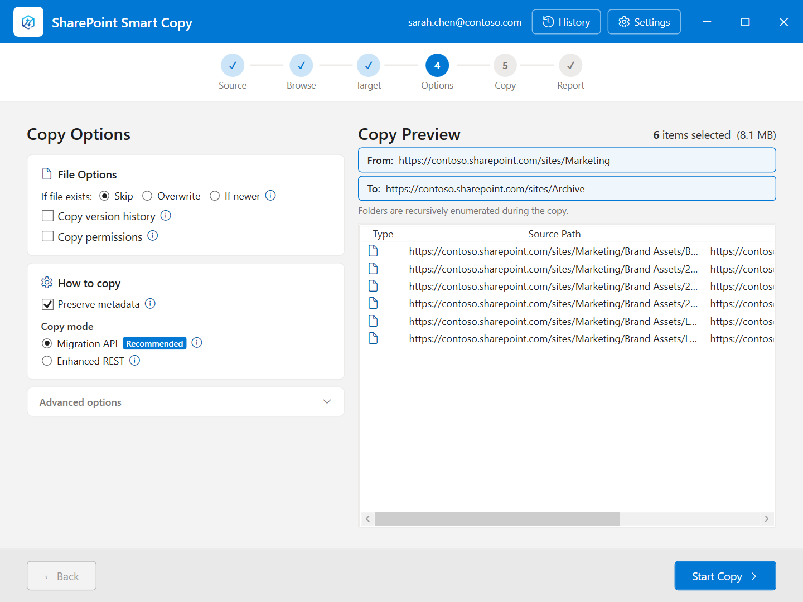 |
| **Browse — choose scope and select files** | **Options — versions, metadata, advanced** |
| 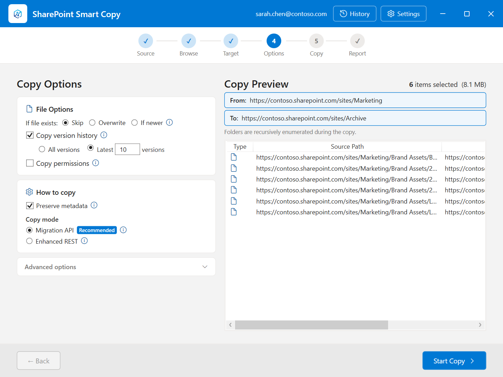 | 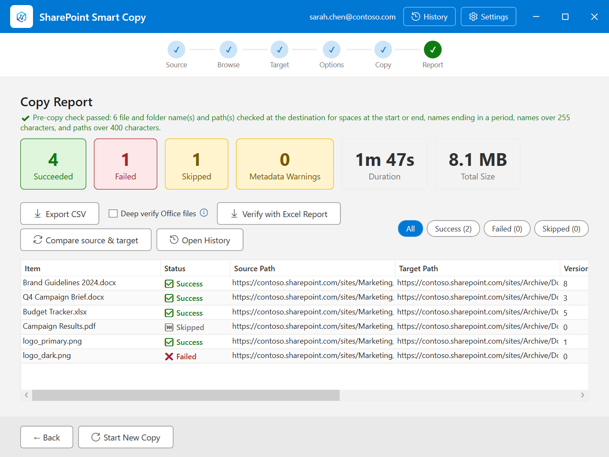 |
| **Options — with version history enabled** | **Report — per-file results and CSV export** |
| 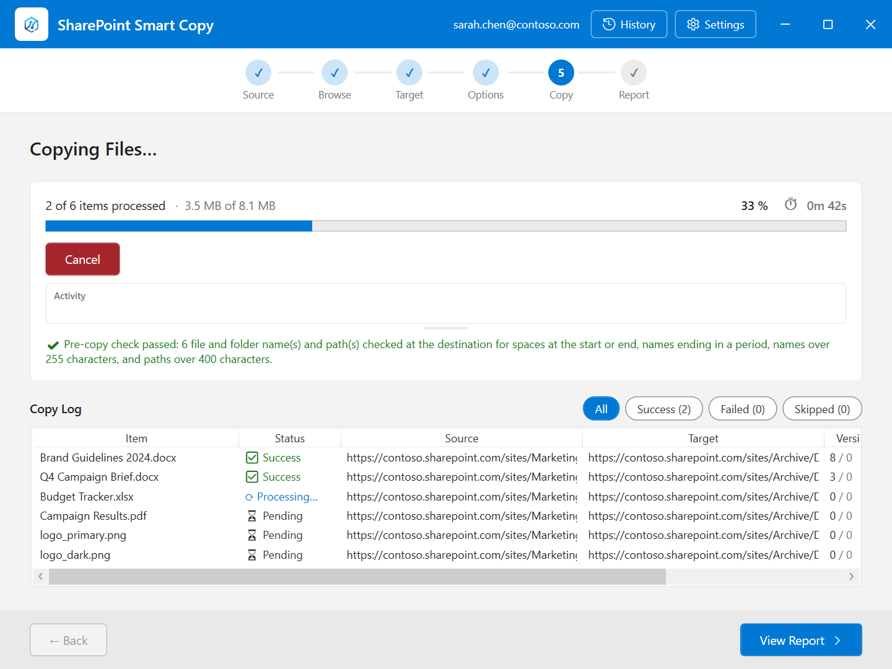 | 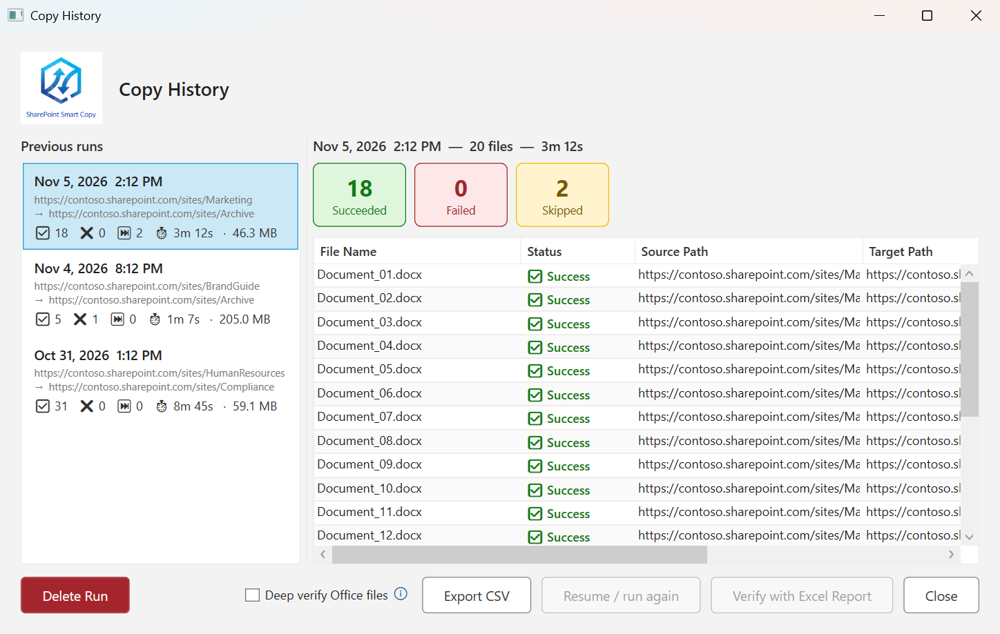 |
| **Progress — real-time file status** | **History — browse previous runs** |
| 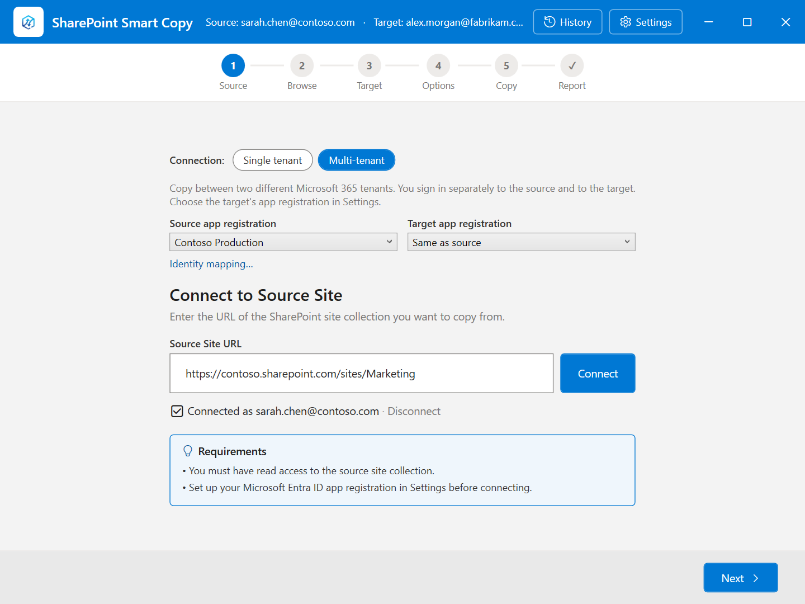 | 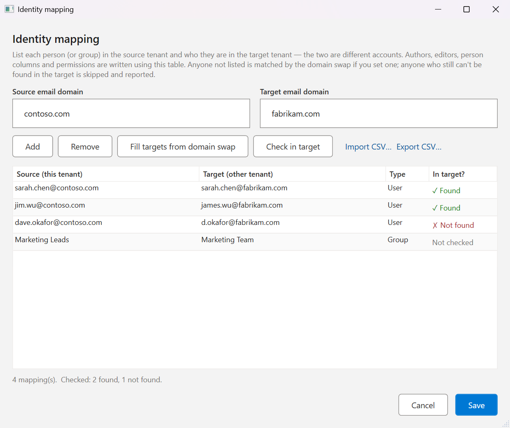 |
| **Multi-tenant — separate sign-in for source and target** | **Identity mapping — who is who in the other tenant** |
| 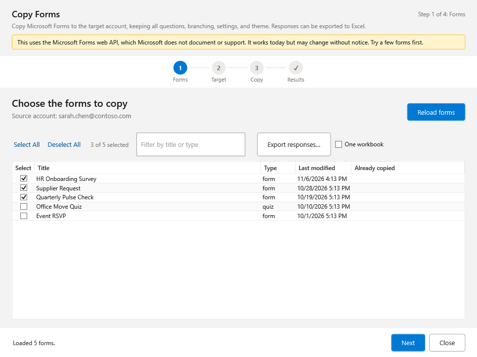 | 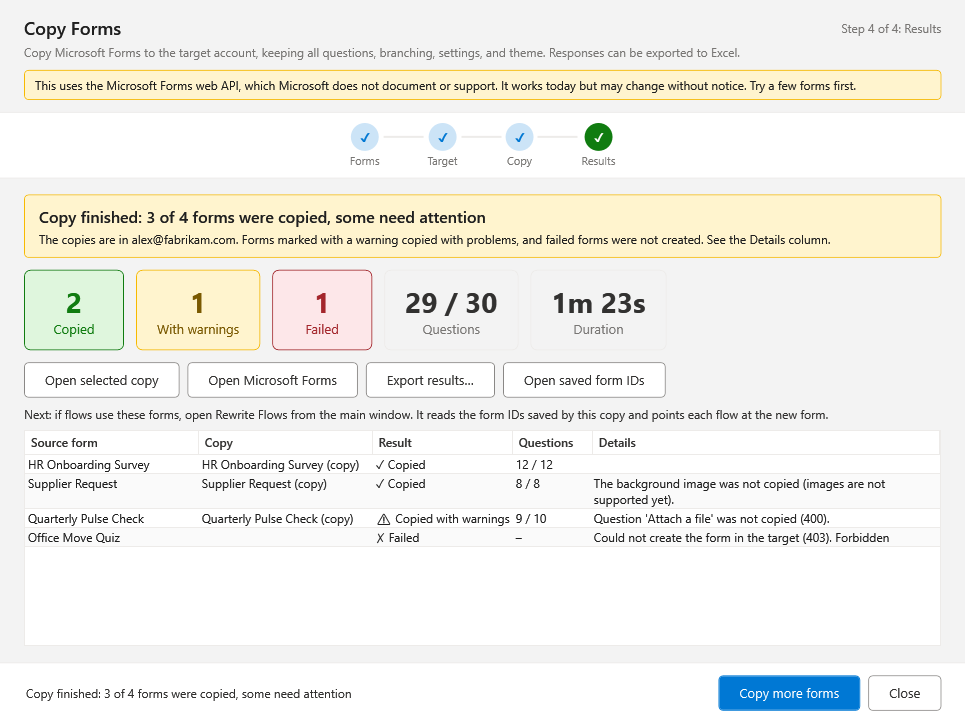 |
| **Forms — choose forms and copy them to the target** | **Forms — results with per-form warnings** |
| 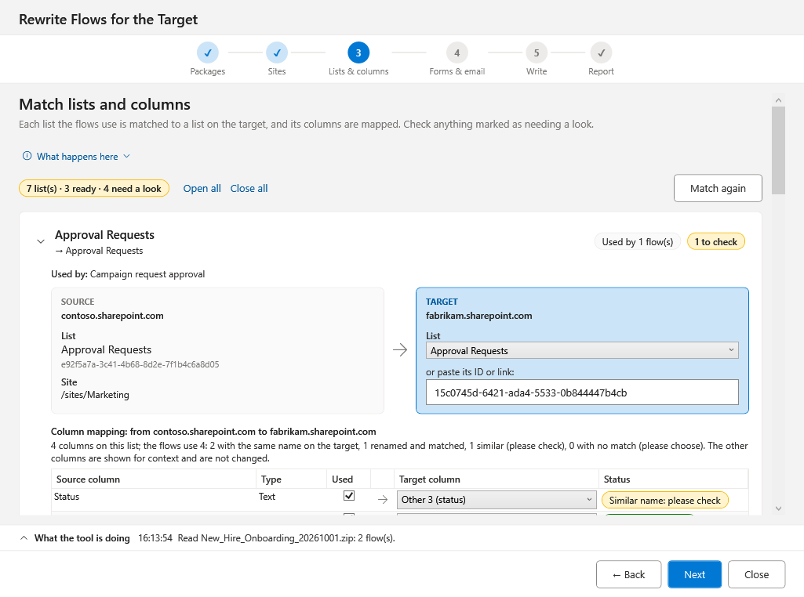 | 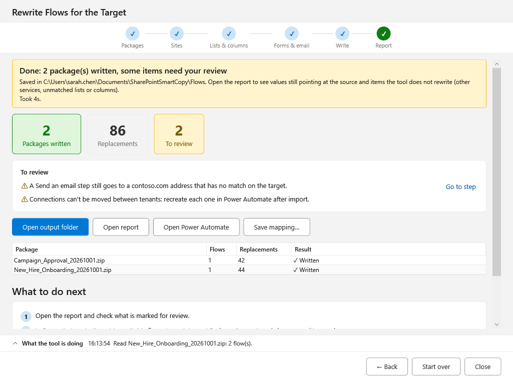 |
| **Flows — match lists and columns** | **Flows — what was written and what to review** |

---

## Installation (No Build Required)

1. **Download** the latest `.exe` from the [Releases page](https://github.com/sregan1/SharePoint-Smart-Copy/releases/latest) — it is a self-contained single-file binary, no extraction needed.
2. **Register an Azure AD app** — follow the [Azure AD App Registration](#azure-ad-app-registration) steps below to create an app registration in your tenant.
3. **Launch** `SharePointSmartCopy.exe`, open **Settings** (⚙ top-right), and enter your Client ID and Tenant ID.
4. **Connect and copy** — enter your source site URL, sign in with your Microsoft 365 account, choose a scope, and follow the wizard.

> **Windows SmartScreen** may show a warning on first launch because the binary is downloaded from the internet. Click **More info → Run anyway**. No .NET runtime installation is required — the runtime is bundled in the executable.

---

## Features

Choose from four copy scopes in a step-by-step wizard: 

| Scope | What it copies |
|---|---|
| **Files** | Selected files and folders from a document library, with full version history and metadata |
| **Libraries & Lists** | Entire document libraries or generic lists — schema, columns, views, settings, content types, versioning settings, and content |
| **Site** | All document libraries and custom lists on a source site, plus site columns, site content types, navigation links, and site settings |
| **Pages** | Modern SharePoint pages (.aspx), with optional web part URL remapping |

**Related tools** (two more tiles on the Browse step, not copy scopes):

| Tool | What it does |
|---|---|
| **Forms** | Copies Microsoft Forms (all question types including Ranking and Likert, branching, quiz type, settings, theme, logo and background images) and exports responses to Excel. Uses the *unofficial* Microsoft Forms API and needs the delegated Microsoft Forms permission on your app registration |
| **Flows** | Rewrites exported Power Automate packages (including solution exports) or copies flows live between environments, for the target tenant: sites, lists (matched by name through your connections), columns (a column the target list lacks is left out of the steps that write it, with a warning), copied forms, and email domains; live copy can create the flows inside a Dataverse solution. Connections must be recreated after a package import |
| **Teams** | A six-step wizard (Connect, Choose, Options, Review, Copy, Results) that copies one team, or several at once (choosing which channels), and any number of chats, to new teams, in the same tenant or in another one: settings, members and owners, every channel (standard, private and shared), the files and, if you choose, the messages and replies with their original time and author. It also copies a chat, with its messages, into a new group chat with the same people. With a client secret saved for the source registration it works as an **administrator**: it lists every team in the tenant and the chats of the people you choose, not just your own. People are found in the target by email through the identity mapping, and the Review step lets you map anyone who has no match. Messages and chats need an application permission and a client secret: see [PERMISSIONS.md](PERMISSIONS.md) |

**All scopes:**
- Custom column values copied in both **Migration API** and **Enhanced REST** modes — including **Person/User**, **Managed Metadata**, **Lookup**, **Hyperlink**, and **Currency** columns
- Custom column mapping dialog — map source columns to target columns, or create missing columns in the target
- **Built-in pre-copy check** — before anything is copied, every file and folder is checked against SharePoint's rules at the destination (leading or trailing spaces, names ending in a period, names over 255 characters, paths over 400 characters). A clean check never interrupts the copy. If something is flagged, the copy pauses before anything is written and lists each item with its full path and the reason, so you can cancel or copy the rest. Flagged items stay on the report so you can fix them and copy again
- Overwrite / skip / **copy-if-newer** incremental mode
- **Adaptive throttle handling** — each Graph-heavy phase backs off and re-probes independently, so large jobs complete without manual intervention or stalling on shared throttle state
- **System sleep is blocked** while a copy, metadata update, or verification is running, so long unattended jobs aren't interrupted
- **Automatic recovery from Migration API batch aborts** — if SharePoint cancels an entire import after hitting its internal per-batch conflict threshold, the app clears the specific conflicting files and retries the batch automatically instead of requiring a manual re-run
- Detailed per-item report with CSV export and inline permission status
- Run history viewable in-app, with an independent **Verification Report** (Excel) that re-scans source and target to confirm every file actually landed
- **Compare** — a standalone dialog (**Compare** under *Other tools* on the Browse step) generates the same kind of difference report for any source and target you connect to, with no copy or saved history required
- **Deep Verify** (optional) — for Office files flagged as mismatched, downloads both copies and compares actual internal content, ignoring only the parts SharePoint itself rewrites on upload, so a hash/date difference can be proven real or harmless instead of left unresolved
- History opens instantly regardless of run size — a saved run's full per-file results load only when you open, export, or verify that run, not for every entry in the list
- **Cancelled status** — items still in progress when a run is stopped or the app closes mid-copy are reported as Cancelled rather than Failed, so an interrupted run's summary doesn't look like a mass failure
- **Large-file transfer reliability** — a self-tuning upload-concurrency gate and a global in-memory byte budget keep libraries containing many very large (multi-GB) files copying without exhausting memory or saturating the upload path
- **Copy between tenants** — a Single tenant / Multi-tenant switch signs in to the source and target with separate app registrations. A **user mapping table** says which source user is which target user (with an email-domain shortcut and **Check in target**), and after a run the report lists anyone the target couldn't find so you can map them
- **Crash recovery and Resume** — a run interrupted by a crash or power loss is recovered as an **Interrupted** History entry, and **Resume / run again** re-runs its selection so only what's missing or changed is transferred
- **Export diagnostics** (Settings) — a redacted zip of logs and system info for bug reports
- **Total Size** shown alongside item counts on the preview, in-progress, and report screens, in the Excel verification report, and in History — including bytes from copied version history, not just each file's current version

**Libraries, Lists and Site scopes — structure of new lists and libraries:**
- **Lookups and managed metadata** — lookup values are matched by the original item (duplicate titles no longer collapse), looked-up lists and child-web lookups are carried along, projected lookup fields are recreated, and a managed-metadata term set can be copied to a different tenant through Microsoft Graph (optional `TermStore.ReadWrite.All` permission); the Column mapping dialog shows what each lookup and managed-metadata column is bound to
- **Update existing lists** — optional, off by default: a list or library that already exists on the target can be brought in line with the source (same-named views and the default view, list settings, column rules and formatting), and the results mark it as updated
- **Structure to copy** — Select all / Clear all, the term-set copy (extra permission) off by default in its own group, and the Options step lists every kind of structure that is recreated (views, list settings, content types, column rules, templates, and in Site scope site columns, navigation and settings) with a checkbox for each, and the report records what a run copied
- **Views** — shared views are recreated with their filter, sorting, grouping, columns and order, paging, totals, formatting and default view; calendar, Gantt, datasheet and board views are created with their own type
- **List settings** — content approval, check-out, attachments, open in browser, folder creation, search visibility, draft visibility, item-level security, and the list's validation rule
- **Column validation rules and formatting**
- **Content types** — custom types are recreated with their columns, and copied items, files and folders (including Document Sets) are put on the matching type
- **Document template and folder default column values** of a library
- **Site scope only** — custom site columns and content types, navigation (left and top), and site settings, before the lists are created
- **Structure only:** untick *Copy files and list items (content)* to copy just the structure (no files or items)
- Lists and libraries the app creates get all of this; ones that already exist on the target only get the missing content types and views (nothing existing is changed). A content type's own document template is copied into the library too. Anything that cannot be copied is listed on the item's result row. See the [User Guide](USER-GUIDE.md) for details and limits

**Files scope:**
- Full version history — version numbers, dates, and per-version editors preserved exactly
- List item version history — a new list item's versions are replayed on the target with each version's values, Modified date and editor (people, lookup, taxonomy and link columns keep their current value only); items that already exist on the target keep their own history
- Folder creation/modification dates, authors, and custom folder color preserved on target, with an option to limit the repair to newly-copied folders for faster repeated incremental runs
- Bulk copy with 1–16 parallel operations
- Migration API mode for high-fidelity large batches; Enhanced REST for small or quick copies
- Migration API engages whenever selected — independent of the Copy Versions toggle
- **OneNote notebooks copy correctly** — copied as a single native server-side operation instead of being rebuilt file-by-file, preserving the special notebook association that would otherwise be lost

**Copy log:**
- **Custom column mismatches are surfaced, not hidden** — a dedicated Custom Fields status column, a Metadata Warnings summary count, and an end-of-run log line flag any value that couldn't be written (e.g. a target column that doesn't actually match by internal name), without marking the file's own copy as failed
- Filter chips — All / Success / Failed / Skipped — on both the progress and report screens
- Scales to 100,000+ files without UI freeze — batched row rendering and coalesced auto-scroll
- Default report/verification filenames are prefixed with the source and target site names, including OneDrive personal sites (e.g. `Marketing-Archive-CopyReport_Files_...csv`) — can be turned off in Settings

**Appearance:**
- Light / Dark / System theme — switchable in Settings
- 30 UI languages (follows the Windows display language, or choose one in Settings → Language; applies on next launch). Arabic and Hebrew use right-to-left layout. Translations are machine-generated and pending native review

---

## Prerequisites

| Requirement | Detail |
|---|---|
| **OS** | Windows 10 or 11 |
| **.NET Runtime** | None to install: the release is self-contained and includes the .NET 10 runtime (x64). To build from source, install the [.NET 10 SDK](https://dotnet.microsoft.com/download/dotnet/10.0) |
| **Microsoft 365** | SharePoint Online tenant |
| **Azure AD** | App registration with delegated API permissions (see below) |

---

## Azure AD App Registration

### 1. Register the app

1. Go to [Entra ID](https://entra.microsoft.com) → **App registrations** → **New registration**
2. Name: `SharePoint Smart Copy` (or similar)
3. Supported account types: **Single tenant** (your org only) is recommended — each Microsoft 365 tenant then gets its own app registration and its own admin consent. Choose **Multitenant** only if you need one app registration reused across multiple tenants; admin consent must still be granted separately in *each* tenant that uses it — consent never carries over between tenants.
4. Redirect URI: **Public client/native** → `http://localhost`
5. Click **Register**
6. Copy the **Application (client) ID** and **Directory (tenant) ID** — you will enter these in the app's Settings dialog

### 2. Add API permissions

Smart Copy needs only **three permissions** to copy files, libraries, lists and sites (the third is for Migration API mode only). **Everything else is optional.** Go to **API permissions** → **Add a permission**:

| API | Type | Permission | Purpose |
|-----|------|-----------|---------|
| Microsoft Graph | Delegated | `Sites.ReadWrite.All` | Browse and read SharePoint sites/files via Graph |
| Microsoft Graph | Delegated | `Files.ReadWrite.All` | Upload/download file content via Graph |
| SharePoint | Delegated | `AllSites.FullControl` | For Migration API mode; can be excluded if you use only Enhanced REST mode |

Each optional feature (managed metadata, Forms, Flows, and every part of Teams) has its own "If you want to…" entry with the extra permissions, in the chart below.

> **Why `AllSites.FullControl`? (Migration API mode only)**
> SharePoint's Migration API (`CreateMigrationJobEncrypted`) performs a server-side site-collection-administrator check.
> With only `Sites.ReadWrite.All`, SharePoint caps the effective OAuth privilege below site-collection-admin level, so even a user who is explicitly a Primary Site Admin will be rejected.
> `AllSites.FullControl` raises the OAuth context to full control so SharePoint recognizes the user's actual admin status.
> If your organization uses Enhanced REST mode only, leave it out.

#### Which permissions does each feature need?

**Required: copying files, libraries, lists and sites.** Smart Copy needs only these permissions for its core job: Files & Folders, Libraries & Lists, Entire Site, Site Pages, Compare and verifying a copy. The third one is for **Migration API mode only**: leave it out if you use only Enhanced REST mode. **Everything below this table is optional**: add a permission only if you want the feature that needs it.

| API | Type | Permission |
|---|---|---|
| Microsoft Graph | Delegated | `Sites.ReadWrite.All` |
| Microsoft Graph | Delegated | `Files.ReadWrite.All` |
| SharePoint | Delegated | `AllSites.FullControl` (for Migration API mode; can be excluded if you use only Enhanced REST mode) |

Without the first two nothing connects to SharePoint. Without the third, Migration API mode is refused ("Permission Denied") and Enhanced REST mode still works. Click **Grant admin consent** once they are added.

**Optional: add only what you want.** Each item says what you want to do, which permissions to add *on top of the required ones*, and what happens if you leave them out. Permissions are **Delegated** (the app acts as the signed-in user) unless marked **Application**.

**If you want to copy managed-metadata (term set) columns to a different tenant**

- Add on the **target** registration: Microsoft Graph, Delegated: `TermStore.ReadWrite.All`
- Add on the **source** registration (when two registrations are used): Microsoft Graph, Delegated: `TermStore.Read.All`
- The signed-in target account also needs a term store role (for example *Term Store Administrator*).
- Without it: the managed-metadata column is not created, and the run report says why.

**If you want to use the Forms tool**

- Add: Microsoft Forms, Delegated: the Microsoft Forms permission (under *APIs my organization uses*)
- Without it: the Forms tile is grayed out, and its tooltip names what to add.
- The Forms tool uses Microsoft's unofficial Forms API.

**If you want the Flows tool to rewrite exported flow packages**

- Add nothing: the two required permissions are enough. Adding the Microsoft Forms permission above also lets it look up form titles.

**If you want Flows to copy flows live between environments**

- Add: Power Automate Service, Delegated: `Flows.Read.All`, `Flows.Manage.All`
- Add: PowerApps Service, Delegated: `User`
- Optional, to create the flows inside a solution: Dataverse, Delegated: `user_impersonation`. The signed-in account also needs a security role that can create flows (for example *Environment Maker*).
- Without it: the Live option is disabled and says why. Packages still work.

**If you want to browse your own Teams and chats**

- Add: Microsoft Graph, Delegated: `Team.ReadBasic.All`, `Channel.ReadBasic.All`, `TeamMember.Read.All`, `Chat.Read`
- Without it: the Teams tile shows a warning, and the tool cannot list your teams and chats.

**If you want to copy teams (without messages), in the same tenant or another one**

- Add the browsing permissions above, plus Microsoft Graph, Delegated: `Team.Create`, `Channel.Create`, `ChannelMember.ReadWrite.All`, `TeamMember.ReadWrite.All`, `TeamSettings.ReadWrite.All`
- Between two tenants, the **target** registration also needs Microsoft Graph, Delegated: `User.ReadBasic.All`
- Without it: the wizard stops on its first step and names the missing permissions.

**If you want to copy Teams messages and replies**

- Add the team-copy permissions above, plus Microsoft Graph, Delegated: `ChannelMessage.Read.All`, `ChatMember.Read`
- Add on the **target** registration: Microsoft Graph, **Application**: `Teamwork.Migrate.All`, and a client secret for that registration, saved in Settings
- Without it: the *Include messages* option is disabled (no client secret), or Microsoft refuses the import (no permission).

**If you want to copy chats**

- Add the message permissions above, plus Microsoft Graph, Delegated: `Chat.Create`
- Add on the **target** registration: Microsoft Graph, **Application**: `ChatMember.ReadWrite.All`
- Without it: the new chat cannot be created, or its messages are imported but its people cannot see them yet (the results say so).

**If you want the Teams administrator view: every team in the tenant, and the chats of people you choose**

- Add on the **source** registration: Microsoft Graph, **Application**: `Group.Read.All`, `Team.ReadBasic.All`, `Channel.ReadBasic.All`, `TeamMember.Read.All`, `ChannelMember.Read.All`, `Files.Read.All`, `User.Read.All`
- Also save a client secret for the **source** registration in Settings. The tool then reads with that registration's own sign-in instead of your account.
- To also read other people's chats, or the messages of teams you are not in, add on the source registration: Microsoft Graph, **Application**: `ChannelMessage.Read.All`, `Chat.Read.All`, `ChatMember.Read.All`. Microsoft also requires its approval of your tenant for the Teams *protected APIs* (a request form); admin consent alone is not enough.
- Without it: the Teams tool lists only your own teams and chats, and a message names what is missing.
- Files of a team you are not a member of are copied with your own sign-in, so they copy only where your account can open the team's site.

**Two registrations (two tenants).** Each side uses its own app registration and its own consent. The source registration needs only what is read from the source; the target registration needs what is written there. A registration used for both sides needs both sets. Grant admin consent in **each** tenant.

**Notes**

- **Admin consent.** Application permissions always need admin consent, and so do most of the Teams permissions. The simplest way is to click *Grant admin consent* once after adding everything.
- **Client secret.** Only the Application features above need one: on the target registration to import Teams messages and chats, and on the source registration for the Teams administrator view. Create it under *Certificates & secrets* on that registration and paste its **Value** (not its ID) into **Settings → Azure app registrations**. It is stored encrypted for your Windows account and is never sent anywhere except to Microsoft's sign-in service.
- **Grayed-out tiles.** Forms is disabled until its permission is on the registration. Teams is never disabled: it shows a warning tooltip you can copy and paste to your administrator.
- **No permissions needed** to browse saved History or open Settings (local only).

The same text is in [PERMISSIONS.md](PERMISSIONS.md). For help working out which permissions your administrator needs to grant, see the [permissions guide](https://sharepointsmartsolutions.com/smart-copy/permissions) on the Smart Copy website.

### 3. Grant admin consent

After adding the permissions, click **Grant admin consent for [your organization]** at the top of the API permissions list.
This pre-authorizes the permissions org-wide so users are never prompted for individual consent.

Without admin consent, users will see an interactive consent dialog on first use.
As a Global Admin you can also check **"Consent on behalf of your organization"** in that dialog, which has the same effect.

### 4. Target site permissions (Migration API only)

The account running the copy must be a **Site Collection Administrator** on the **target** site:

> Site Settings → Site Collection Administrators → add your account

Being a Global Admin or SharePoint Admin grants effective access to all sites but does **not** automatically populate the Site Collection Administrators list for a specific site. You must add the account explicitly.

This requirement applies only to Migration API mode. Enhanced REST mode works with standard contributor access.

---

## Configuration

Launch the app and open **Settings** (gear icon):

- **Client ID** — Application (client) ID from the app registration
- **Tenant ID** — Directory (tenant) ID (leave blank for multi-tenant)

Source/target URLs and copy preferences are configured within the wizard and remembered between sessions.

---

## Copy Modes (Files scope)

When copying files with version history enabled, two copy modes are available.

### When to use each mode

| Scenario | Recommended mode |
|---|---|
| Large batch (50+ files or 200+ versions) | Migration API |
| Full version history fidelity required | Migration API |
| Small batch or a quick one-off copy | Enhanced REST |
| Copying current version only (no history) | Enhanced REST |
| User lacks Site Collection Admin rights | Enhanced REST |
| Need to see per-file progress in real time | Enhanced REST |

The copy mode option appears in the **How to copy** card on the Options screen when **Copy versions** is enabled.

### Migration API

Uses SharePoint's built-in [Migration API](https://learn.microsoft.com/en-us/sharepoint/dev/apis/migration-api-overview). Files are packaged client-side, uploaded to SP-provisioned Azure Blob containers, then imported server-side by SharePoint.

**Advantages**
- Version numbers on target exactly match source (1.0, 2.0, 3.0, …)
- Modified By and Modified date correct per version in history
- Author and Created date preserved on the file
- Bypasses per-item throttling — SP processes the batch as a single job, not thousands of individual API calls
- Scales well: 500 files with 10 versions each has roughly the same client-side overhead as 50 files

**Limitations**
- Minimum ~1–2 minutes of overhead per run regardless of file count (container provisioning, manifest packaging, blob upload, SP processing)
- No per-file progress during SP's processing phase — results appear only after the full job completes
- Error reporting is at the job level; individual file failures may have limited detail
- Requires elevated permissions (see above)

### Enhanced REST

Uses the SharePoint REST and Microsoft Graph APIs directly. Each file version is uploaded individually, with metadata and timestamps patched immediately after.

**Advantages**
- Results appear per file as each one completes — you see progress in real time
- Low overhead for small batches: a 5-file copy completes in seconds
- No elevated permissions required beyond standard contributor access
- Per-file error messages are clear and immediate

**Limitations**
- Version numbers are 2× the source count (e.g. versions 2, 4, 6 for a 3-version source file) — a SharePoint REST constraint; the correct dates and editors are still preserved
- Subject to SharePoint throttling (HTTP 429) on large batches with high parallelism
- Slower than Migration API for large migrations with many versions

---

## Troubleshooting

**"Migration job rejected — access denied" even though I'm a Site Admin**
The Migration API requires the OAuth token to carry `AllSites.FullControl`. Without it, SharePoint rejects the request regardless of the user's actual admin role. Add `AllSites.FullControl` to the app registration's API permissions and re-grant admin consent.

**"Migration API failed" but I have AllSites.FullControl**
The running account must also appear explicitly in **Site Settings → Site Collection Administrators** on the target site. Being a Global Admin or SharePoint Admin at the tenant level is not sufficient — you must add the account to that specific site's administrators list.

**Consent dialog appears on every sign-in**
Admin consent has not been granted for the app registration. A Global Admin must click **Grant admin consent for [organization]** on the API permissions page in Entra ID, or check **"Consent on behalf of your organization"** the first time the consent dialog appears.

**"Approval required" / "Need admin approval" screen appears instead of a consent prompt**
This means the tenant's consent policy blocks users from granting these permissions themselves — only a Global Administrator can. It's expected, not a bug, and it means admin consent hasn't been fully granted for this tenant yet:
- Confirm the person who clicked **Grant admin consent** was a **Global Administrator** — Cloud Application Administrator/Application Administrator can add permissions but may not fully consent to all of them.
- Verify **both** the Microsoft Graph and SharePoint permission rows show a green "Granted for [tenant]" status — they're consented independently.
- If a permission was added after admin consent was last granted, click **Grant admin consent** again.
- As a shortcut, a Global Admin can visit `https://login.microsoftonline.com/{tenant-id}/adminconsent?client_id={app-client-id}` to grant tenant-wide consent directly.
- **Admin consent is per-tenant and does not transfer.** Deploying to a new Microsoft 365 tenant (a new customer, a second environment) requires repeating the full Azure AD App Registration setup — including a fresh admin consent grant — inside that tenant.

**Sign-in browser window does not open**
The app has no Client ID configured. Open **Settings** (⚙ top-right) and enter the Application (client) ID from your Azure AD app registration.

**"File is checked out at source" errors in the report**
Files checked out in SharePoint cannot be read by the API. Check them in at the source before copying, or use the CSV export from the report to identify and retry them individually.

**A copy fails partway and the report doesn't say why**
Each run writes an `activity-*.log` to `%LocalAppData%\SharePointSmartCopy\Logs`, with the full text of SharePoint's error responses. It contains file names and site URLs, so remove anything sensitive before attaching it to a GitHub issue. **Settings → Export diagnostics…** saves a separate zip of recent logs and system info with organization details removed; it does not include the activity log. See the [User Guide](USER-GUIDE.md#sharing-diagnostics-when-you-report-a-problem).

---

## Key Dependencies

| Package | Version | Purpose |
|---------|---------|---------|
| `Microsoft.Graph` | 5.x | Graph API client (site/file browsing, download, Enhanced REST upload) |
| `Microsoft.Identity.Client` | 4.x | MSAL — interactive sign-in and token management |
| `Azure.Storage.Blobs` | 12.x | Upload encrypted blobs to SP-provisioned containers (Migration API) |
| `Microsoft.SharePointOnline.CSOM` | 16.x | `EncryptionOption` type used in Migration API package |
| `CommunityToolkit.Mvvm` | 8.x | MVVM source generators for the WPF view models |

---

## About

Originally created and released in May 2026 by Sean Regan.

Copyright (c) 2026 Vivity, Inc.

Part of SharePoint Smart Solutions, a software product brand of Vivity, Inc.

## Disclaimer

This software is provided "as is", without warranty of any kind, under the terms of the MIT License. To the extent permitted by law, Vivity, Inc. and the authors are not
liable for any loss or damage arising from its use. Copying data between
SharePoint sites and tenants can overwrite or miss content: verify the results (the Verification Report helps) before you rely
on a copy or remove a source. The Forms tool uses an unofficial Microsoft Forms API that Microsoft does not document or
support and may change without notice. This project is not affiliated with or endorsed by Microsoft. SharePoint, Microsoft
Forms, Power Automate and Microsoft 365 are trademarks of Microsoft Corporation.

## License

[MIT](LICENSE) © 2026 Vivity, Inc.
