# SharePoint Smart Copy — User Guide

*Copy files and folders between SharePoint Online sites*

**Version 4.1.0  ·  October 2026**

---

## Table of Contents

1. [Overview](#1-overview)
2. [Security](#2-security)
3. [System Requirements](#3-system-requirements)
4. [Setup — Azure App Registration](#4-setup--azure-app-registration)
5. [Step-by-Step Guide](#5-step-by-step-guide)
6. [Copy Modes — Detailed Reference](#6-copy-modes--detailed-reference)
7. [Copy History](#7-copy-history)
8. [Troubleshooting](#8-troubleshooting)

---

## 1. Overview

SharePoint Smart Copy is a Windows desktop application that copies files and folders between SharePoint Online site collections, preserving full version history and metadata. Whether you are migrating content to a new site, archiving documents, or reorganizing your SharePoint environment, a guided wizard handles version history, metadata preservation, and parallel transfers — no scripting or PowerShell required.

Two copy engines are available. **Migration API** mode uses SharePoint's server-side import pipeline to achieve exact version fidelity — the same version numbers, dates, and editors appear on the target as on the source. **Enhanced REST** mode calls the Graph API directly for each version, preserving dates and editors but producing version numbers that are 2× the source count due to a SharePoint REST constraint. Both modes authenticate through your existing Microsoft 365 credentials.

### Key Capabilities

- Copy individual files, entire folders, complete document libraries, entire sites, or modern pages
- Preserve version history — copy all versions or limit to the N most recent
- **Migration API mode** — exact version numbers, exact dates, exact editors (requires Site Collection Admin on target)
- **Enhanced REST mode** — correct dates and editors per version; no admin rights required
- **Copy-if-newer** incremental mode — only copies files that are newer on the source, skipping files already up to date
- **Person/User, Managed Metadata, Lookup, Hyperlink, and Currency columns** copied alongside content in both copy modes — no manual field re-entry
- Custom column mapping dialog — map source columns to matching target columns or create missing ones
- **Custom Fields status column** flags any column value that couldn't be written (e.g. a target column that looks identical but doesn't actually match by internal name), so a partial metadata mismatch is never mistaken for a fully clean copy
- Automatic HTTP 429 throttle handling — large jobs complete without interruption
- Parallel transfers with 1–16 simultaneous file copies for faster bulk operations
- Real-time progress monitoring with per-file status updates (Enhanced REST) or job-level results (Migration API)
- Copy report with succeeded, failed, and skipped counts, inline permission status, and CSV export
- **Total Size** shown alongside item counts on the preview, in-progress, and report screens, in the Excel verification report, and in History
- **OneNote notebooks** copy correctly as a single native operation, preserving their special notebook association instead of being rebuilt as a plain folder of files
- **Verification Report** — independently re-scans source and target after a run and produces an Excel workbook confirming what actually matches
- **Compare** — generate the same kind of difference report for any source and target you connect to, without needing a prior copy or a saved history entry
- **Copy between two tenants** — Multi-tenant mode signs in to source and target separately, with a user mapping table and **Check in target**; the report lists people the target couldn't find so you can map them (see Section 5)
- **Resume / run again** and **crash recovery** — a run cut short is recovered as an Interrupted History entry and can be resumed
- Full copy history stored locally — browse, re-export, resume, or delete previous runs
- System sleep is blocked automatically for the duration of a copy, metadata update, or verification
- ← Back navigation available on every step, including the final report screen
- Light, Dark, and System-follows-Windows themes
- 30 interface languages — follows your Windows display language by default; change it under Settings → Language (takes effect the next time the app starts). Translations are machine-generated and pending native-speaker review

---

## 2. Security

SharePoint Smart Copy is built on Microsoft's own identity platform and never handles your credentials directly. All communication is with Microsoft's servers only.

### Authentication — OAuth 2.0 / MSAL

When you click **Connect**, your default browser opens to Microsoft's login page — the exact same page you use to sign in to SharePoint, Teams, or any other Microsoft 365 service. The application never sees your password. After you authenticate, Microsoft returns a short-lived access token which the app uses to call the Graph API on your behalf.

### No Stored Credentials

Your Microsoft 365 password is never entered into or stored by the application. The access token is held in memory only for the duration of the session and discarded when the application closes. If you select **Remember me** in the browser during sign-in, the Microsoft Authentication Library (MSAL) stores a refresh token in the Windows Credential Manager — the same secure store used by Microsoft Office applications.

### Delegated Permissions — Acts as You

The application uses delegated permissions, meaning it acts as the signed-in user. It can only access content that your account already has permission to access through SharePoint. It cannot touch any site, library, folder, or file that you could not access in your own browser.

### AllSites.FullControl — Migration API Only

When Migration API mode is used for version history, the SharePoint API permission `AllSites.FullControl` is required. This is still a delegated permission — the application acts as the signed-in user and is limited to what that user can actually do. The permission raises the OAuth context to site-collection-admin level so SharePoint recognizes the user's existing admin status; it does not grant any access beyond what the signed-in account already holds.

> **Note:** `AllSites.FullControl` is only exercised during Migration API jobs. Enhanced REST mode does not require it. If your organization does not want to grant this permission, use Enhanced REST mode instead.

### Your Own App Registration

You create and own the Microsoft Entra ID app registration in your organization's tenant (see [Section 4](#4-setup--azure-app-registration)). Your IT department controls which permissions are granted, who may use the application, and can revoke access at any time through the Azure portal — with no involvement from any third party.

### No External Servers or Telemetry

All data transfers occur directly between your computer and Microsoft's Graph API and SharePoint services. There are no intermediate servers, no analytics pipeline, and no telemetry. Your files never leave Microsoft's infrastructure.

### Local Storage Only

The only data written to your local machine is:

- **Application settings** (Microsoft Entra ID registration IDs) — `%AppData%\SharePointSmartCopy\settings.json`
- **Copy history reports** — `%AppData%\SharePointSmartCopy\Reports\` (filenames and status only, no file content)
- **MSAL token cache** — managed by the Microsoft Authentication Library in the Windows Credential Manager

> **Note:** The application keeps no copy of your files. Content is streamed from the source SharePoint site to the target. In **Enhanced REST** mode, files of 100 MB or more (and files whose size is not known in advance) are held in a temporary file in your Windows temp folder while they transfer. That file is readable only by your Windows account and is deleted automatically as soon as the file's transfer ends. In **Migration API** mode, file content is encrypted before it is uploaded to the Azure storage container that SharePoint provides for the import.

---

## 3. System Requirements

- Windows 10 (version 1809 or later) or Windows 11
- .NET 8 Desktop Runtime — download free from microsoft.com/dotnet
- Internet access to Microsoft 365 / SharePoint Online
- A default browser for the initial Microsoft 365 sign-in flow
- An Azure Active Directory / Entra ID app registration (see [Section 4](#4-setup--azure-app-registration))

### SharePoint Permissions Required

The signed-in Microsoft 365 account must have:

- Read access (Visitor or higher) on all source libraries and folders being copied from
- Contribute or higher access on the target SharePoint site and destination folder
- If copying version history: **Edit** or higher on the source library (required to read version history via the Graph API)
- If using Migration API mode: **Site Collection Administrator** on the target site (Site Settings → Site Collection Administrators)

> **Note:** Site Collection Administrator is distinct from SharePoint Administrator at the tenant level. Even a Global Admin must be added explicitly to the Site Collection Administrators list on the specific target site.

---

## 4. Setup — Azure App Registration

Before using SharePoint Smart Copy for the first time, a one-time setup is required: registering the application in your organization's Azure Active Directory (Entra ID). This grants the application the delegated permissions needed to call the SharePoint Graph API on behalf of the signed-in user. The process takes approximately five minutes.

### Step 1 — Create the App Registration

1. Sign in to [portal.azure.com](https://portal.azure.com) as a Global Administrator or Application Administrator.
2. Navigate to **Azure Active Directory** (or **Microsoft Entra ID**) → **App registrations** → **New registration**.
3. Enter a display name such as `SharePoint Smart Copy`.
4. Under **Supported account types**, choose **Accounts in this organizational directory only** (or the option that matches your organization's requirements).
5. Under **Redirect URI**, select **Public client/native (mobile & desktop)** from the drop-down, then enter: `http://localhost`
6. Click **Register**.

### Step 2 — Grant API Permissions

1. In your new app registration, go to **API permissions** → **Add a permission**.
2. Choose **Microsoft Graph** → **Delegated permissions**. Search for and add: `Sites.ReadWrite.All`
3. Still under **Microsoft Graph** → **Delegated permissions**. Search for and add: `Files.ReadWrite.All`
4. Click **Add a permission** again. Choose **SharePoint** → **Delegated permissions**. Search for and add: `AllSites.FullControl`
5. Click **Grant admin consent for [your organization]** and confirm. This requires the Global Administrator role (Cloud Application Administrator can add permissions but may not be able to fully consent to all of them).

> **Note:** `AllSites.FullControl` (SharePoint delegated) is required for Migration API mode. If your organization uses only Enhanced REST mode, this permission can be omitted — but the app will display an error if Migration API is selected without it.

> **Optional — only for the Forms tool:** to copy Microsoft Forms, also add **Microsoft Forms** → **Delegated permissions** (search "Microsoft Forms" under *APIs my organization uses*) and grant consent. It is not needed for any other feature. See [Copying Forms and Flows](#copying-forms-and-flows).

#### Which permissions does each feature need?

Every sign-in asks for the two Microsoft Graph permissions, so they are needed for anything that connects to SharePoint. The other two are only needed by the features marked below. If you do not use a feature, you can leave its permission out.

| Feature | Graph `Sites.ReadWrite.All` | Graph `Files.ReadWrite.All` | SharePoint `AllSites.FullControl` | Microsoft Forms |
|---|:-:|:-:|:-:|:-:|
| Files & Folders, Libraries & Lists, Entire Site — **Enhanced REST** mode | ✔ | ✔ | — | — |
| Files & Folders, Libraries & Lists, Entire Site — **Migration API** mode | ✔ | ✔ | ✔ | — |
| Site Pages (always Enhanced REST) | ✔ | ✔ | — | — |
| **Compare**, and verifying a copy | ✔ | ✔ | — | — |
| **Forms** tool | ✔ | ✔ | — | ✔ |
| **Flows** tool | ✔ | ✔ | — | optional* |
| Browsing saved History, Settings (local only; verifying a run signs in like Compare) | — | — | — | — |

\* The Flows tool only uses Microsoft Forms to look up form titles and the target account's forms. Without the permission those lookups report an error and you paste each new form's ID or edit-page link instead; everything else in Flows works.

For example, a company that only wants to move Power Automate flows needs the two Graph permissions and nothing else: no Microsoft Forms permission, and no `AllSites.FullControl`. Flows reads your packages from disk and looks up lists and columns on the source and target sites with the same sign-in.

> **Important — admin consent is per-tenant:** Consenting to these permissions in one Microsoft 365 tenant has no effect on any other tenant. If you're deploying to a new customer or a second tenant, repeat this entire Azure App Registration section — a new app registration, new permissions, and a fresh **Grant admin consent** click — inside *that* tenant. Consent can never be reused across tenants.

### Step 3 — Copy Your Application ID

On the **Overview** page of your new app registration, copy the **Application (client) ID** — a GUID in the format `xxxxxxxx-xxxx-xxxx-xxxx-xxxxxxxxxxxx`. You will need this in the next step.

### Step 4 — Configure SharePoint Smart Copy

Launch SharePoint Smart Copy and click the **Settings** button (⚙) in the top-right corner of the application window.

*Settings dialog — add and manage Microsoft Entra ID app registrations*

1. Click **Add** to create a new registration entry.
2. Enter a friendly **Name** for the registration, e.g. `Contoso Production`.
3. Paste the **Application (client) ID** from Step 3 into the **Client ID** field.
4. Enter your **Tenant ID** — use your organization's domain (e.g. `contoso.onmicrosoft.com`) or the tenant GUID. If unsure, enter `common`.
5. Ensure your registration is selected in the list on the left.
6. Click **Save**.

> **Note:** You can add multiple app registrations (for example, one for production and one for a dev tenant) and switch between them by selecting the active one before clicking Save.

---

## 5. Step-by-Step Guide

SharePoint Smart Copy guides you through a six-step wizard. The step indicator at the top of the window shows your current position. You can navigate back to any previous step at any time — including from the final report screen — using the **← Back** button at the bottom of the window, except while a copy is actively in progress.

### Step 1 — Connect to Source

Enter the full URL of the SharePoint site collection you want to copy from — the root URL of the site, for example:

```
https://company.sharepoint.com/sites/hr-documents
```

Click **Connect**. Your browser opens to the standard Microsoft 365 sign-in page. After signing in with an account that has Read access to the source site, the status bar confirms the connected user.

*Step 1 — Source site URL entered and connected*

Click **Next →** to proceed.

### Step 2 — Browse and Select Files

The application loads all document libraries from the source site into a tree view. Expand a library or folder by clicking the arrow to reveal its contents. Check the box next to any file, folder, or library you want to include in the copy.

*Step 2 — Browse and select files from the source site*

- Checking a folder automatically selects all files and sub-folders within it.
- Clicking a fully-checked folder again cycles it to an indeterminate state (shown with a dash) — the folder itself is deselected but its children remain selected, letting you exclude just the folder's own direct files while still copying its subfolders.
- Use **Select All** to check everything across all libraries, or **Deselect All** to clear all selections.
- File type icons indicate the format: 📝 Word, 📊 Excel/PowerPoint, 📄 PDF, and so on.
- File sizes are displayed to the right of each file name.

Click **Next →** once your selection is complete.

### Step 3 — Connect to Target

Enter the full URL of the SharePoint site you want to copy **TO**, then click **Connect**. If you already authenticated in Step 1, the connection is usually silent — no browser sign-in required.

*Step 3 — Target site connected and destination folder selected*

After connecting, the right panel shows the target site's document libraries as a folder tree. Click any folder to select it as the destination — the selected path is highlighted in blue. All selected source items will be copied into this folder.

Click **Next →** to proceed to copy options.

### Step 4 — Copy Options

Configure how the copy operation should behave:

*Step 4 — Copy options and copy preview*

- **Overwrite mode** — a three-way selector controlling what happens when a file already exists at the destination:
  - **Skip existing** — files already present at the destination are left untouched and recorded as Skipped in the report.
  - **Overwrite** — files with matching names are replaced unconditionally.
  - **If newer** — files are copied only when the source is more recently modified than the target. Files already up to date are recorded as Skipped.
- **Copy versions** — when checked, SharePoint version history is copied alongside each file. Requires versioning to be enabled on the source library.
- **Parallel copies** — controls how many files (or Migration API jobs) run simultaneously. The default of 8 is a good balance; raise to 8 or 16 on a fast connection for large batches.
- **Preserve metadata** — when checked, folder Created/Modified dates, Author/Editor, and custom folder color are copied to the target. The **Re-apply folder metadata every run** option underneath it (on by default) controls whether that repair runs for every folder on every run, or only for folders receiving new files this run — turning it off speeds up repeated incremental runs on large libraries where most files are already up to date.

When **Copy versions** is enabled, two additional controls appear:

*Step 4 — Version and copy mode options (visible when Copy versions is checked)*

- **Copy all versions** — copies the complete version history for every file.
- **Latest N versions** — copies only the N most recent versions of each file.

The **Copy mode** selector is always available in Advanced options and controls how files are transferred:

- **Migration API (Recommended)** — version numbers on the target exactly match the source (1.0, 2.0, 3.0…), with the correct Modified date and editor per version, and correct folder creation/modification dates and Created By/Modified By. With Copy Versions off, only the current version is imported via the same fast batched path. Requires Site Collection Administrator on the target site. Hover the ⓘ icon for a summary.
- **Enhanced REST** — correct dates and editors per version, but version numbers are 2× the source count (e.g. 2, 4, 6 for a 3-version file) due to a SharePoint REST constraint. No admin rights required. Hover the ⓘ icon for a summary.

> **Note:** Choose **Migration API** when exact version numbers matter or for large batches. Choose **Enhanced REST** when you do not have Site Collection Admin rights, or for small quick copies where sequential numbering is not critical.

The right panel shows a preview of the top-level items to be copied. Click **Start Copy →** to begin.

### Step 5 — Copy in Progress

The progress bar shows the overall percentage complete. The counter shows completed / total files and the elapsed time updates every 400 milliseconds.

*Step 5 — Copy in progress with real-time file status*

Each file appears in the list with its current status:

| Icon | Status | Description |
|------|--------|-------------|
| ⏳ | Pending | Waiting in the transfer queue |
| ⟳ | Copying | File transfer is in progress |
| ✅ | Success | Copied successfully (version count shown when version copying is enabled) |
| ❌ | Failed | An error occurred; the reason appears in the Error column |
| ⏭ | Skipped | File already exists at the destination and Overwrite was not enabled |
| 🚫 | Cancelled | Still in progress when the run was stopped or the app was closed — not attempted, and not counted as a failure |

Use the **filter chips** (All / Success / Failed / Skipped) above the file list to focus on a subset of results — useful when copying thousands of files. Cancelled items appear under the **Failed** chip, since they're still unfinished work, but they're counted separately in the summary so an interrupted run doesn't look like a mass failure.

Click **Cancel** to stop the copy at any time. Files already transferred remain in the destination — the operation is not rolled back. When all files are processed, the **Next →** button becomes active.

### Step 6 — Copy Report

The report screen summarizes the completed copy with four summary cards (a fifth, **Cancelled**, appears only if the run was stopped early):

*Step 6 — Copy report with summary cards and per-file results*

| Card | Meaning |
|------|---------|
| Green — **Succeeded** | Number of files copied successfully |
| Red — **Failed** | Number of files that could not be copied (see the Error column for details) |
| Yellow — **Skipped** | Files not copied because they already existed at the destination |
| **Duration** | Total elapsed time for the entire copy operation |
| **Cancelled** *(hidden when zero)* | Items still in progress when the run was stopped or the app was closed — not attempted, so not counted as Failed |

The full per-file results table is shown below the summary cards. Use the **filter chips** (All / Success / Failed / Skipped) to narrow the list. Available actions:

- **← Back** — returns to Step 5 (progress screen) to review the run details, or navigate further back through the wizard
- **Export CSV** — saves the complete report to a comma-separated file. The suggested filename is prefixed with the source and target site names (e.g. `Marketing-Archive-CopyReport_Files_....csv`); turn this off in **Settings** if you'd rather not have it
- **Start New Copy** — begins another copy operation; your sign-in session is reused automatically
- **Compare source & target** and **Open History** — open the Compare tool and the run history without leaving the report
- **Failed / Skipped cards** — click a card to filter the list to just those items

### Copying Between Two Tenants (Multi-tenant Mode)

On the first screen, choose **Multi-tenant** next to **Connection** when the source and the target are in **different** Microsoft 365 tenants. In the default **Single tenant** mode both sites share one sign-in, exactly as described above.

> **Note:** Multi-tenant mode has been tested against two tenant pairs, but other setups (guest accounts, conditional access, very large libraries) may behave differently. Try it on a small library first and check the result with a Verification Report, and please report anything unexpected on GitHub.

1. **Create an app registration in each tenant** (Section 4) and add both in **Settings**. Each tenant's administrator must grant consent for its own registration.
2. On the first screen, choose the **Source app registration** and the **Target app registration**. You sign in to each site separately, with an account from that tenant. The title bar shows both accounts (*Source: … · Target: …*).

   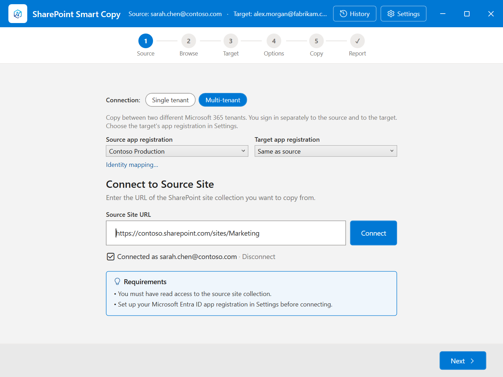
3. Click **Identity mapping…** (on the first screen or the Target screen) to say who is who in the two tenants:
   - **Source / Target email domain** — a shortcut: an address such as `jane@contoso.com` is written to the target as `jane@fabrikam.com`. Guest accounts (`…#EXT#…`) are not rewritten.
   - **The table** — one row per person or group: the source user on the left, the matching target user on the right (users by email address, groups by name). A row always wins over the domain swap. Use **Add** and **Remove**, **Import CSV…** / **Export CSV…**, and **Fill targets from domain swap** to propose a target for rows you have left empty. Rows with a problem (a blank cell, a duplicate source, source equal to target) are highlighted and must be fixed before you can save.
   - **Check in target** looks each target email up in the target tenant and shows **✓ Found** or **✗ Not found** next to it. It needs the target site's URL (enter it on the Target screen first). Looking a user up also adds them to the target site's user list, which the copy does anyway before it can make them an author or give them access.

   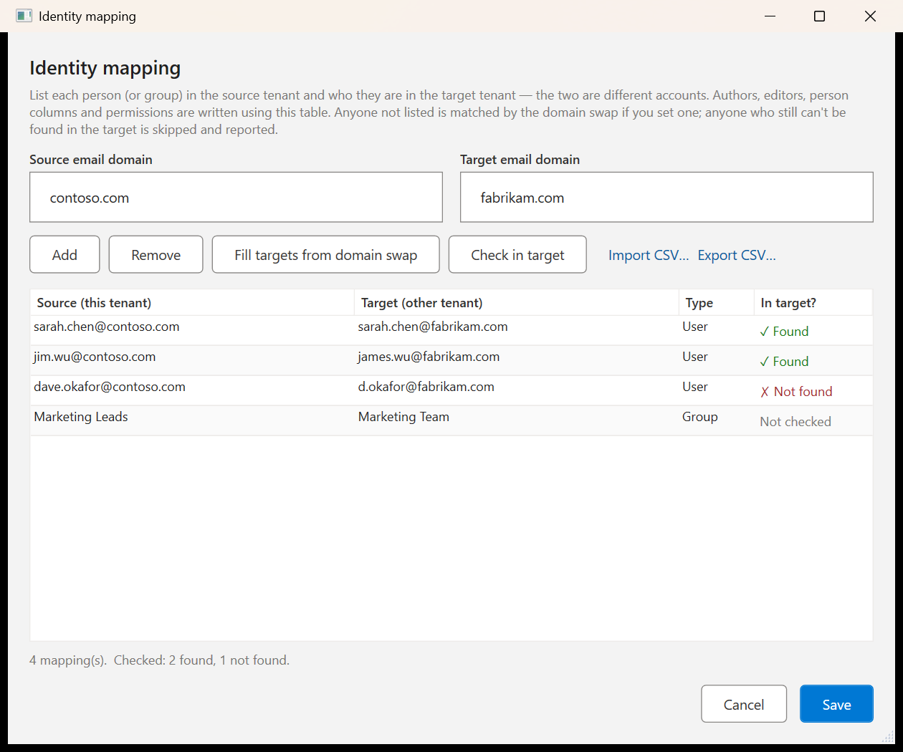
4. Authors, editors, person columns and permissions are written using that mapping. Anyone who cannot be found in the target is left out — not given access, not set as author or editor, dropped from person columns — and recorded.
5. When a run finishes and anyone could not be found, the report shows a banner with **Map these users…**, which opens the table already filled in with those people (with a suggested target from the domain swap where possible). **History → Map unresolved users…** does the same for an earlier run. Saving a mapping applies to the **next** run: Copy if newer skips files that are already up to date, so the authors on files that were already copied do not change. Run again with **Overwrite** to re-stamp them. Permissions are refreshed on skipped files either way.

   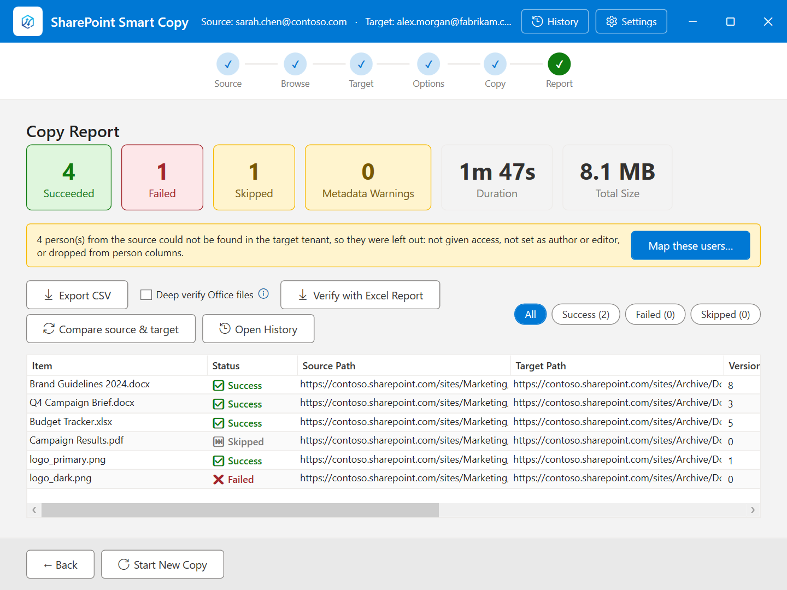

   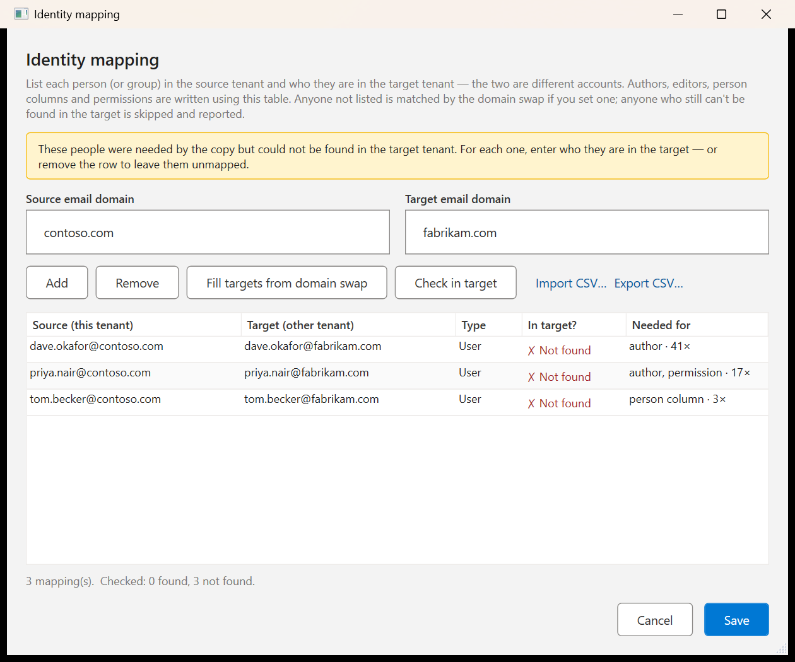

What differs from a same-tenant copy:

- **Managed-metadata (taxonomy) columns and their values are not copied** — term IDs only exist in the tenant that owns the term store.
- **OneNote notebooks and document sets cannot be copied** between tenants yet; they are reported as failed with an explanation.
- **Entra groups do not carry over** unless you map them with an override.
- The source and target must be on **different SharePoint hosts**. For two sites in the same tenant, use Single tenant mode.
- Switching between Single tenant and Multi-tenant disconnects both sites (you are asked first).

### Copying Forms and Flows

On the **Browse** step, below the four copy-scope tiles, an **Other tools** row has two buttons, **Forms** and **Flows**, that open their own tools. They are not copy scopes: they use the sign-ins you already made (Single tenant: one shared sign-in; Multi-tenant: the source and target sign-ins).

> **Unofficial API.** The Forms tool talks to the Microsoft Forms web API, which Microsoft does not document or support. It works today but may change without notice. Try a few forms first.

**Forms** — four steps, like the main copy wizard:

1. **Forms** — your forms load as soon as the dialog opens (you may be asked to sign in); **Reload forms** reads them again, and **Load my forms** is the retry if the first attempt failed or was cancelled. Your own forms are listed; forms owned by Microsoft 365 groups and forms shared with you are not listed yet. Tick the forms to copy; the **filter box** narrows the list by title or type (**Select all** then takes just the visible forms), and the **Already copied** column shows forms you copied before. **Export responses…** (bottom left) writes one Excel file per ticked form, or one workbook with a sheet per form if **One workbook** is ticked; responses can't be re-submitted into a copy. If a selected form was already copied to the same account, you are asked before a second copy is made.

   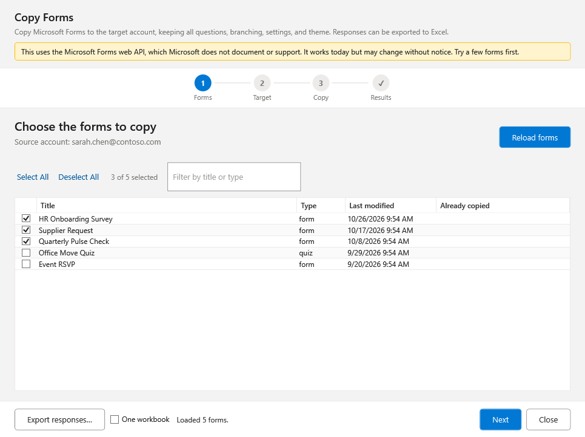

2. **Target** — choose where the copies go. In *Single tenant* mode they are created in the same account, next to the originals. In *Multi-tenant* mode this step has its own **Sign in to the target account** button (separate from the SharePoint sign-ins) and confirms that the account can use Microsoft Forms before you can continue. You can add a suffix to the copied titles here.

   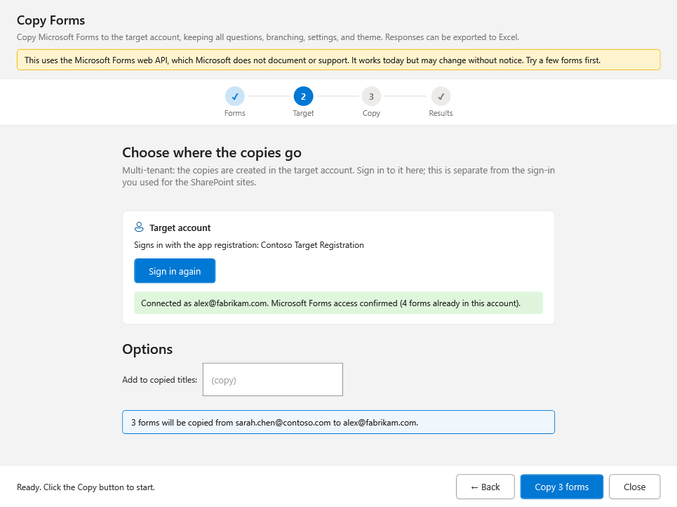

3. **Copy** — shows progress form by form. **Cancel** stops after the current form (Cancel is also available while loading, signing in and exporting). Closing the window during a copy asks first, because it can leave a half-built form in the target.
4. **Results** — a dashboard like the file copy's report: how many forms copied, copied with warnings, or failed, how many questions copied, and how long it took. The table lists each form with the reason for any warning or failure. **Open selected copy** and **Open Microsoft Forms** jump to the copies, **Export results…** saves the table to Excel, and **Show form ID map** opens the file the Flows tool uses. **Copy more forms** starts again.

   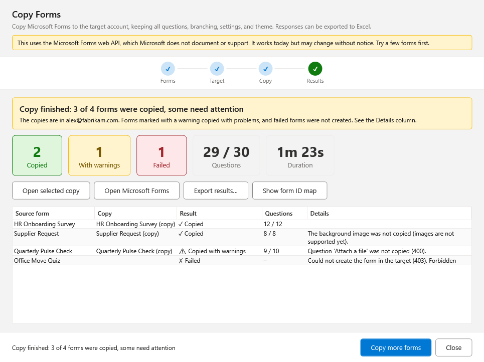


Each copy keeps all questions (with their original IDs), choice branching, quiz type, settings, and theme. After each copy the tool checks that the copy has as many questions as the source. Ranking options and Likert scales are copied too, and so are the form's logo, background, and header images: each is uploaded to the new form, then checked on the copy. If an image cannot be added, a copy of the file is saved in `Documents\SharePointSmartCopy\Forms images` and the warning names it, so you can add it in Microsoft Forms by hand. Quiz scoring is not verified; that is noted in the results.

**Flows** — six steps. The same layout runs through all of them: **SOURCE** (grey) is where your flows come from and **TARGET** (blue) is where they go, each with its tenant address. Every step opens with one line saying what happens, and a **What happens here** link for the longer reason. A small **What the tool is doing** strip at the bottom shows the latest action; click it to see the whole log (it opens by itself when something fails).

1. **Packages** — export your flows in Power Automate (**Export → Package (.zip)**) and add the files, or drag them onto the window. Each package is listed with the flows found in it and how many sites and lists they use; **✕** removes one. Add the **original** exports from the source, not packages this tool wrote earlier (the tool recognizes those and warns). Solution exports (.zip files with a `Workflows` folder) are read too. **Have a saved mapping? Load it…** fills the following steps from a mapping you saved earlier. **What these flows use** (closed by default) lists the services the flows use and what the tool does about each.

   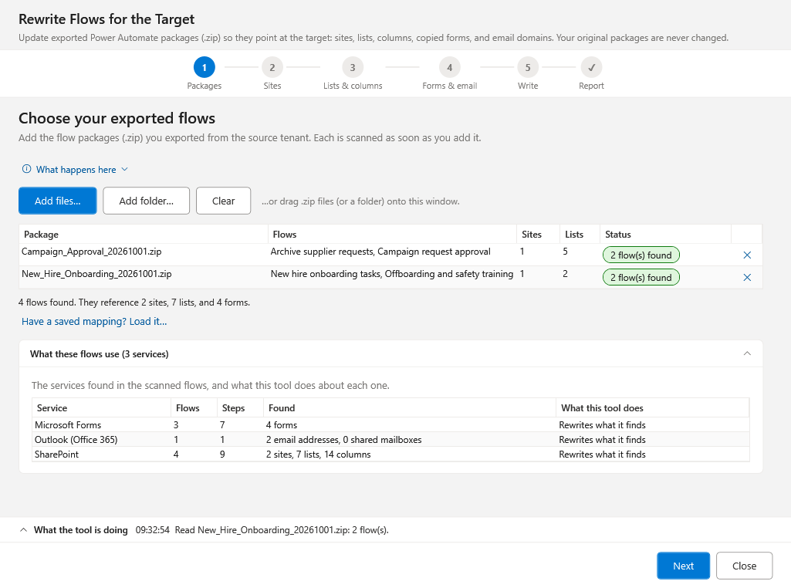

2. **Sites** — shows where each flow's site moves to. The **Source** and **Target** lines show each tenant's address, the account it is connected as, and a state chip. In *Multi-tenant* mode, **Change source…** signs in to the source again, and **Sign in to target…** signs in to the target (the window always opens, so you can switch account or browser; the button turns into **Cancel** while it waits). The tool reads the target tenant's address from the account and fills in every empty target site with the same path on it. The table is **From** (the address in your flows), **To** (the target site, editable) and a status chip. A site left empty is not changed, and the report lists it. If a flow's sites are on a different tenant than your source connection, **Advanced: read lists from a different address** opens by itself with the corrected address. One warning at a time is shown under the connections.

   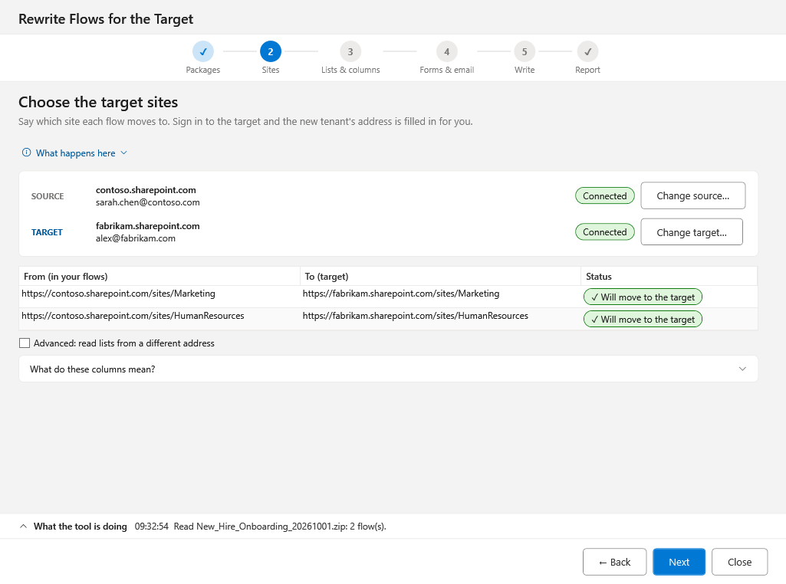

3. **Lists & columns** — **one card per list** the flows use, however many flows use it. A card has a header (the list's name, which target it goes to, how many flows use it, and a status chip) and opens into a **SOURCE** pane (tenant, list name and ID, site) and a **TARGET** pane (tenant, a dropdown of every list on the target site, or paste an ID). The same-named target list is chosen for you. Below is the **column mapping** from source to target: the columns the flows use (tick "Show all columns" for the rest) with the target column chosen for you. You only need to act on cards marked **Needs a look** and rows marked *Similar name* or *No match*; a row you fix stops asking for attention. If the source list cannot be read, the card says why and still lets you map, using the column names found in the flow. If the list's ID is already a list on the target (a package this tool wrote), the card says **Already on target**. The summary line at the top ("7 lists · 5 ready · 2 need a look") always matches the cards.

   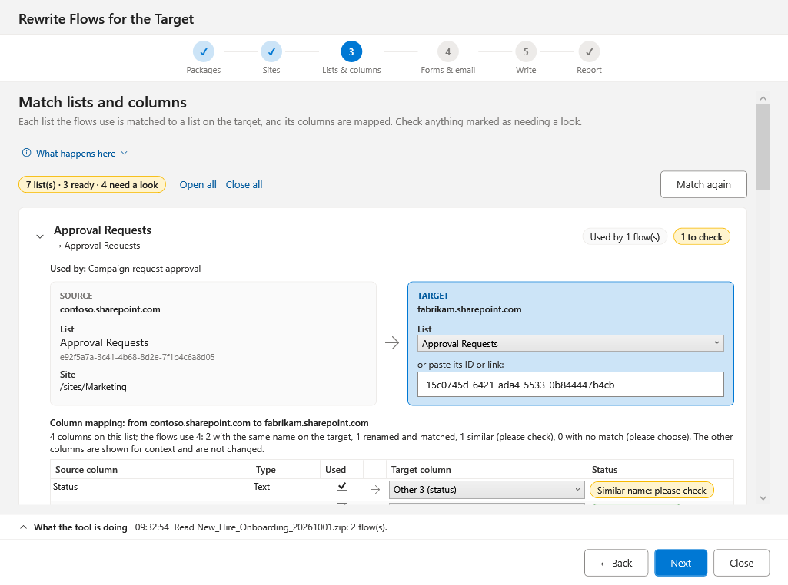

**Next stays off until the flows would work.** On Sites (Multi-tenant: target signed in, every site has a target), Lists & columns (every list has a target list, every column the flows use exists there, and every column the target list requires is filled in by the flow's Create item steps, or by a value you type on the list card, which the tool adds to those steps) and Forms & email (a valid target form), the footer says what is in the way. Fix it, use **Check again** on a list card after changing the list in SharePoint, and Next turns on.

4. **Forms & email** — each form in your flows is shown with its target. A flow only stores a form's ID, form names load automatically when you arrive (**Load form names…** retries): the tool reads each form's title from Microsoft Forms (source account, including forms shared with it) and the forms the target account owns, and reports what it found on each side right under the button (or why it could not). A form whose title matches exactly one target form (or "title (copy)") is matched for you; otherwise pick the new form from the dropdown, or paste its ID or edit-page link. Either works, and **Cancel** stops a pending sign-in. The dropdown lists only forms the target account owns, not group-owned forms. **Other values** (email addresses, the tenant ID, library paths) are grouped by kind. Values the tool filled in from your sign-ins are marked **✓ filled in**; **Clear values filled in automatically** undoes them. Email domains are one sentence: *Move every address on [domain] to [domain]*.

   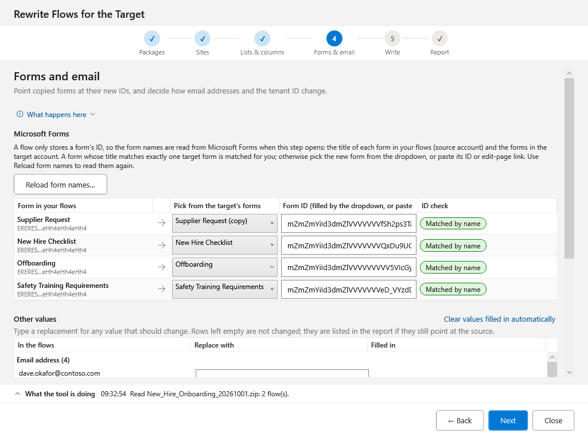

5. **Write** — a **Ready to write?** list says where everything stands (packages, sites, lists, columns, forms, email); a line that needs a look has a **Go to step** link. Choose the output folder (it is remembered) and the name of each updated package in the **Names of the updated packages** card (type a new name per package, or use **Keep the original names** or **Add ' - migrated'**). When you click **Write updated packages**, a Save As dialog opens for each package with that name filled in; you can change the folder or name there, the tool refuses to save over an original, and Cancel writes nothing. **Save mapping…** keeps your choices as a JSON file.

   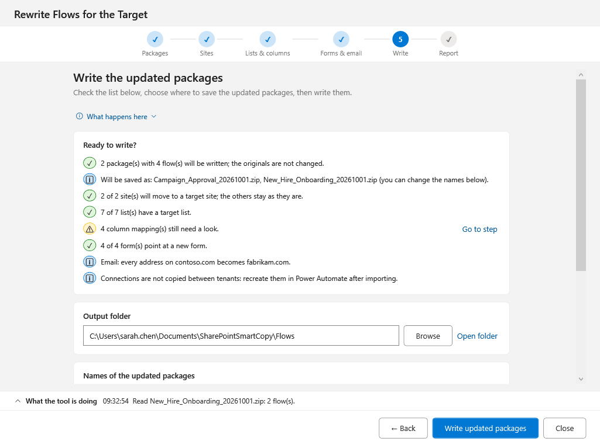

6. **Report** — what was written, how many replacements were made, and **To review**: each item the tool could not settle, in words, with a **Go to step** link where one step fixes it. **Open output folder**, **Open report**, **Open Power Automate** and **Save mapping…** are one click away, and **What to do next** is numbered. `rewrite-report.html` (also saved as `rewrite-report.md`) lists what the flows use, what to do after import, and every change.

   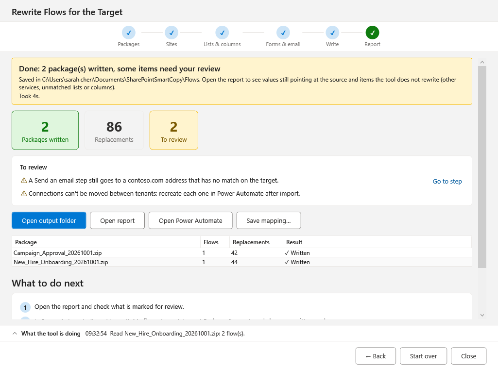

After importing a package into Power Automate, **recreate each connection and re-select it** — connections can't be moved between tenants. Import flows turned off, review them, then turn them on. Your original packages are never modified.

**Requirements and limits**

- Forms needs the delegated **Microsoft Forms** permission on the app registration (see Step 2 of the Azure setup). If it is missing, the dialog shows a hint.
- Legacy flow packages are fully supported. For solution exports only the flow definitions are rewritten; environment variables and connection references in the solution are not, and the report says so.
- The tool edits the same values you would change by hand in a package's `definition.json` (form ID, site URL, list GUIDs, column names), and writes a new package for you to import.
- Column names inside complex flow expressions are matched by pattern; review the report.

---

## 6. Copy Modes — Detailed Reference

### Choosing a Mode

The **Copy mode** option appears on the Copy Options screen when **Copy versions** is enabled.

| Scenario | Recommended Mode |
|----------|-----------------|
| Large batches (50+ files or 200+ versions) | Migration API |
| Exact version numbers required | Migration API |
| Full migration fidelity needed | Migration API |
| Small batches or quick one-off copies | Enhanced REST |
| No Site Collection Admin rights | Enhanced REST |
| Per-file progress in real time | Enhanced REST |

### Migration API

Uses SharePoint's built-in Migration Import API (SPMI). Files are packaged client-side, uploaded to SP-provisioned Azure Blob containers, then imported server-side by SharePoint.

**Advantages:**

- Version numbers on target exactly match source (1.0, 2.0, 3.0, …)
- Modified By and Modified date correct per version in history
- Author and Created date preserved on the file
- Bypasses per-item throttling — SP processes the batch as a single job
- Scales well: 500 files with 10 versions each has roughly the same client-side overhead as 50 files

**Limitations:**

- Minimum 1–2 minutes of overhead per run regardless of file count (container provisioning, manifest packaging, blob upload, SP processing)
- No per-file progress during SP's processing phase — results appear only after the full job completes
- Error reporting is at the job level; individual file failures may have limited detail
- Requires `AllSites.FullControl` delegated permission and Site Collection Administrator membership on the target site
- Any single file version larger than 2 GB cannot be copied in this mode (each version is buffered fully in memory for encryption) — use Enhanced REST for files with a version this large

### Enhanced REST

Uses the SharePoint REST and Microsoft Graph APIs directly. Each file version is uploaded individually, with metadata and timestamps patched immediately after.

**Advantages:**

- Results appear per file as each one completes — you see progress in real time
- Low overhead for small batches: a 5-file copy completes in seconds
- No elevated permissions required beyond standard contributor access
- Per-file error messages are clear and immediate

**Limitations:**

- Version numbers are 2× the source count (e.g. versions 2, 4, 6 for a 3-version source file) — a SharePoint REST constraint; the correct dates and editors are still preserved
- Subject to SharePoint throttling (HTTP 429) on large batches with high parallelism
- Slower than Migration API for large migrations with many versions

---

## 7. Copy History

Every completed copy run is saved automatically to the local history. Access it by clicking the **History** button in the top-right corner of the application window.

*Copy History — list of previous runs*

The left panel lists previous runs in reverse chronological order. Each entry shows the source and target site URLs, a summary of file counts (succeeded / failed / skipped), and the total duration. Click any run to select it and view its details.

*Copy History — run selected, showing per-file details*

With a run selected, the right panel shows the summary cards and the complete per-file results table for that run. Available actions:

- **Export CSV** — saves the selected run's per-file report to a comma-separated file, with the same source/target site name filename prefix as Step 6 (see Settings to turn it off)
- **Resume / run again** — reconnects and re-runs the selected run's selection with **Copy if newer**, so files that were already copied are skipped and only what is missing or changed is transferred. Available for runs that copied a file selection. Custom column mappings are not restored; set them again on the Options step if you used them.
- **Verify** — runs an independent Verification Report for the selected run (see below)
- **Delete Run** — permanently removes the selected run from the history
- **Close** — returns to the main application window

A run that was cut short — the app was closed, crashed or lost power mid-copy — is recovered the next time you start the app and appears here marked **INTERRUPTED**, with the items that had finished. Use **Resume / run again** to carry on.

> **Note:** History is capped at 50 entries. When the limit is reached, the oldest entries are automatically pruned. All history is stored locally in `%AppData%\SharePointSmartCopy\Reports\` — it is never uploaded or shared.

### Verification Report

The copy report itself only reflects what the app *attempted* — the Verification Report independently confirms what is actually present, by re-scanning both the source and target with fresh Graph API calls rather than reusing any data collected during the copy.

Select a run in History and click **Verify**. You will be prompted for a location to save an Excel (`.xlsx`) workbook, then the app re-walks the source and target folder trees. This can take some time on large libraries — the status line shows files found on each side as the scan progresses, and shows a throttle notice if the Microsoft Graph API is rate-limiting the scan, so a slow scan is never mistaken for a hang. Click **Cancel** at any point to stop the verification.

The resulting workbook contains:

| Sheet | Contents |
|---|---|
| **Overview** | A one-glance headline (✓ all files match, or ⚠ content does not match) followed by summary counts — matched, content mismatch, date mismatch, only in source, only in target |
| **Source** | Every file found on the source side, with its relative path |
| **Target** | Every file found on the target side, with its relative path |
| **Comparison** | Every relative path with its match status (Match, Content Mismatch, Date Mismatch, Only in Source, Only in Target, or Unverified), plus the Source Value/Target Value that were compared and a Note explaining anything Deep Verify found |
| **Scan Errors** | Present only if a source or target root could not be scanned (e.g. it was deleted or renamed since the copy) |

> **Note:** Whether a file went missing is confirmed by relative path (does a file with the same name and location exist on both sides). Whether its *content* actually matches uses a different signal depending on file type, because a single approach doesn't work for everything:
>
> - **Most file types** (PDFs, images, archives, and other non-Office formats) get a genuine content comparison — Microsoft Graph's content hash for the source and target files must match exactly. A difference is reported as **Content Mismatch**.
> - **Office and Outlook files** — modern Word/Excel/PowerPoint/Visio formats (`.docx`, `.xlsx`, `.xlsb`, `.pptx`, `.vsdx`, and their template/add-in variants) and legacy binary formats (`.doc`, `.xls`, `.ppt`, `.vsd`, `.pub`, `.mpp`, `.msg`) — can't rely on a hash comparison. SharePoint routinely re-serializes these files' internal container (the ZIP structure behind modern formats, or the OLE metadata streams behind legacy ones) for indexing, thumbnails, and co-authoring, which changes the file's size and hash without changing its actual content. If the hash happens to match anyway, that's still trusted as a genuine match; otherwise these files fall back to a **modified date** comparison (within a few seconds' tolerance) — the app is already responsible for preserving the source's modified date onto the target, so a mismatch here means that didn't happen. This is reported as **Date Mismatch**. If neither a hash nor a modified date is available on both sides, the file is reported as **Unverified** rather than assumed to match.
>
> **Preserve Metadata must have been enabled on the original copy** for the Office-file date check to be meaningful — if it was off, the target's date was never set to match the source, and a Date Mismatch does not necessarily indicate a real problem.
>
> Verification can only be run for saved reports that recorded their source/target scope. Runs from before this feature was added do not have that information, and the **Verify** button is disabled for them.

**Deep verify Office files** (optional checkbox next to Verify): the date-based check above proves SharePoint preserved the modified date, not that the file's actual content matches — a rewritten-but-corrupt Office file could still pass. Checking this box downloads both copies of every modern Word/Excel/PowerPoint/Visio file (`.docx`/`.xlsx`/`.pptx`/`.vsdx` and variants) whose hash or date disagreed, and compares their actual internal content, ignoring only the specific parts SharePoint itself rewrites (Document ID stamps, custom document properties, and similar metadata). A file that's byte-identical in content is reported as an ordinary **Match** — with a Note on the Comparison tab explaining it was confirmed by deep verify — even though its raw hash differed. This is slower — it downloads files rather than just listing them — so it only runs on files that need it, but every flagged file is always checked; there's no cap or time limit that would leave some unverified. Off by default; legacy binary Office formats and non-Office files are unaffected by this option.

### Compare (Source vs. Target)

On the **Browse** step, click **Compare** in the **Other tools** row (below the copy-scope tiles) to generate a difference report between any two locations — without needing a prior copy or a saved History entry first. This is useful for checking whether a site copied by another means (or edited independently on both sides since a copy) still matches, or for a one-off audit that was never meant to be a full copy job.

*Compare — connect to any source and target and pick a library or folder on each side*

Connect a **Source** and a **Target** independently, the same way you would in the main wizard, then select a library or folder in each side's tree. Click **Compare with Excel Report** to scan and save the resulting workbook — it's produced by the same engine and has the same sheet layout (Overview/Source/Target/Comparison/Scan Errors) as the Verification Report above, including the optional **Deep verify Office files** checkbox. A Compare run is never saved to History.

---

## 8. Troubleshooting

### Cannot connect to source or target site

- Verify the URL is the full root URL of the site collection, e.g. `https://company.sharepoint.com/sites/sitename` — not a document library URL.
- Confirm the signed-in account has at least Read access (Visitor permission level) on the site.
- Check that admin consent has been granted for `Sites.ReadWrite.All`, `Files.ReadWrite.All`, and `AllSites.FullControl` in the Azure portal.
- If the browser shows **Need admin approval** / **Approval required**, admin consent is missing or incomplete for *this specific tenant*. Have a Global Administrator for that tenant do the following:
  - Confirm they're signed in as **Global Administrator** — Cloud Application Administrator or Application Administrator may not be able to consent to all of these permissions.
  - Open the app registration's **API permissions** page and verify every row — both the Microsoft Graph block and the SharePoint block — shows a green "Granted for [tenant]" status. If a permission was added after consent was last granted, click **Grant admin consent** again to cover it.
  - As a one-click alternative, visit `https://login.microsoftonline.com/{tenant-id}/adminconsent?client_id={app-client-id}` while signed in as Global Admin — this grants tenant-wide consent directly without navigating the portal.
- **Admin consent does not transfer between tenants.** If this is a new Microsoft 365 tenant, repeat the full Azure App Registration setup in Section 4 — including a fresh admin consent grant — inside that tenant; consent granted for another tenant's app registration has no effect here.

### Migration API — Permission Denied

- Ensure `AllSites.FullControl` delegated permission is added to the Microsoft Entra ID app registration and admin consent has been granted.
- Ensure the signed-in account is listed in **Site Settings** → **Site Collection Administrators** on the target site. Tenant-level SharePoint Admin or Global Admin roles are not sufficient on their own.
- If you cannot obtain these permissions, switch to **Enhanced REST** mode — it does not require admin rights.

### Files are failing with errors

- **File too large** — SharePoint Online supports files up to 250 GB. Files above this limit cannot be copied.
- **"File version is X GB — larger than the 2 GB this mode can buffer" (Migration API mode)** — a single version of the file exceeds what this mode can hold in memory during encryption. Switch to **Enhanced REST** mode for that file (or the whole batch).
- **File is checked out** — check the file back in at the source site before retrying.
- **Permission denied** — verify the signed-in account has Contribute or higher access on the target folder.
- **Path too long** — SharePoint Online has a 400-character limit on the full URL path. Shorten folder names or use a shallower structure.
- **Throttling (429 Too Many Requests)** — the Microsoft Graph API rate-limits heavy usage. The application retries automatically, but very large batches may take longer.
- **"SharePoint aborted the batch after N name conflicts" in the activity log (Migration API mode)** — this is expected automatic recovery, not a failure. SharePoint's Migration API cancels an entire import batch once enough files at the destination already exist, which would otherwise discard every other valid file in that batch. With **Skip existing** selected, the app marks the conflicting files Skipped (matching what Skip means) and resubmits the rest once. With **Overwrite** or **If newer**, the app clears the conflicting targets and resubmits the whole batch once. If a retry still fails, the affected files are reported individually in the final results — re-running the copy again typically clears them, since a fresh pre-flight scan re-detects the current state of the target.
- **A file shows "⚠ Warning" in the Custom Fields column** — the file itself copied successfully; only one or more custom column values could not be written. Check the Custom Fields Details column for the reason. The most common cause is a target column that looks identical to its source counterpart (same display name and values elsewhere) but doesn't actually share the same internal name — SharePoint auto-suffixes a column's internal name at creation time if it collides with another field, so "Notes" on the source and "Notes" on the target can silently be different fields underneath. Open the Column Mapping dialog and confirm the source column is mapped to the target's real internal name (visible in **Library Settings** → click the column → the `Field=` value in the URL), rather than relying on the display name to match automatically.

### Lookup columns — how they copy and where they can't

A Lookup column stores a pointer to an item in another list, and item IDs differ between source and target. So the copy matches each value by its **display text** (the column's "show field", usually Title) against the items in the target column's bound list, and writes the matching target item's ID. This works in both copy modes and between tenants.

For a value to come across:

- The target must have a **Lookup column** of that name, bound to a list that has an item with the same display text. When a library, list or site is copied, the column is recreated and bound to the target list with the **same title** as the source's lookup list. In **Files** scope, "Create in target" does the same.
- The lookup list's **items must already be at the target.** In Site scope this is done for you: every library and list is created first, columns that couldn't bind yet are added once all lists exist, custom-list items are copied (lists that others look up come first), and library files are copied last.

**Known limitations** — these are not bugs to report; they are not supported today:

- **Duplicate display text** — if two target items have the same display text (two items titled "Q1"), every value resolves to the one with the lowest ID. Matching is by text, not by the original item.
- **Lookups to a different site** — a column that looks up a list on another site is not recreated (the target list can't be found by title on the target site), and its values are skipped.
- **Lookups to a document library's files** — libraries are copied after custom lists, so a lookup that points at a library's items finds nothing to match on the first run. Run the copy again after the library has been copied.
- **Library scope with a mix of libraries and lists** — only **Site** scope creates all lists and libraries up front. In Library scope, libraries are copied before the lists you selected, so a library column that looks up one of those lists may need a second run after the lists have been copied. Among the selected lists themselves, ones that others look up are copied first.
- **A same-named column that isn't a Lookup** — if the target already has a column with that name but a different type (for example Text), the values are not written and the Custom Fields Details column says so. Rename or remove it and copy again.
- **Items missing at the target** — a value whose display text matches nothing is reported as "unresolved"; the file or item itself still copies.

### Version history not copying

- Versioning must be enabled on the source document library (**Library Settings** → **Versioning Settings**).
- The signed-in account needs **Edit** or **Design** permission on the source library to read version history via the Graph API.
- If version copying repeatedly fails for specific files, try reducing **Latest N versions** to a small value (e.g. 3) instead of copying all versions.

### Slow copy performance

- Increase the **Parallel copies** slider on the Options screen. Values of 8 or 16 significantly improve throughput on fast connections.
- For very large batches (thousands of files), **Migration API** mode typically outperforms Enhanced REST significantly.
- SharePoint throttles requests during peak hours. Running large operations outside business hours typically yields better performance.

### Token expired or re-authentication required

Access tokens are valid for approximately one hour. If the application has been idle, click **Connect** on Step 1 — MSAL will attempt a silent token refresh. If silent refresh fails, your browser will open for re-authentication. Previous selections and settings are preserved.

### The connection error tells me to open Settings

Connection problems that come from the app registration (no Client ID yet, the wrong Tenant ID, a missing redirect address, consent not granted) are explained in plain language under the **Connect** button, with an **Open Settings** button when the fix is there. The technical detail is kept in brackets at the end of the message — include it if you ask for help.

### Sending diagnostics to support

In **Settings**, click **Export diagnostics…** to save a zip with recent logs, basic system information and your settings with organization details removed. It does not include copy reports, file names or site URLs.

### Settings not persisted

Settings are written to `%AppData%\SharePointSmartCopy\settings.json`. On managed corporate machines, Group Policy may restrict writes to the AppData folder. Contact your IT department to verify write access to the `AppData\Roaming` location for your user profile.
